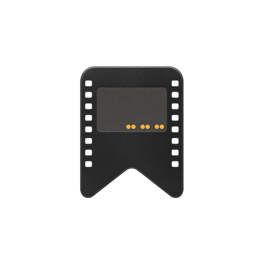

<p align="center">
  
</p>
<h1 align="center">胶片随记</h1>

把每一次快门，留到照片洗出来以后。

胶片随记是一款 Android 胶片拍摄记录应用。拍完一张，用手机记下时间、地点和曝光参数；冲洗扫描后，再把照片与当时的记录放在一起。

**从装卷、拍摄到冲洗归档，把一卷胶片的前后经过串起来。** 项目工作区名为“胶片痕迹”，当前应用名称仍为“胶片随记”。

| 想做什么 | 可以怎样用 |
| --- | --- |
| 记住每张照片怎么拍的 | 记录时间、地点、光圈、快门和备注，附上参考照片 |
| 看看每卷拍到哪了 | 按拍摄中、冲洗中和归档管理胶卷，查看帧号与进度 |
| 拍摄时少翻几个工具 | 使用测光、曝光换算、景深、ND、倒易律与长曝光计时 |
| 扫描后找回拍摄现场 | 导入扫描照片，与对应曝光记录关联，制作分享图 |
| 保存和交换资料 | 创建完整备份，或用 CSV 导入、导出拍摄记录 |

## 从一卷胶片开始

1. **装卷**：选择胶片，按需要关联相机、填写名称和项目。有多种封面的胶片可以横向滑动选择；35 mm 胶卷支持半格设置。
2. **拍摄记录**：拍完后点击快速记录，补充曝光参数、地点、备注或参考照片。也可以从桌面组件打开胶卷、进入记录或测光。
3. **回卷与冲洗**：拍完后回卷，继续记录冲洗信息。达到标称张数后仍可继续记录，以实际拍摄为准。
4. **扫描与归档**：导入扫描照片，关联对应帧号，再将胶卷归档，方便日后查看。

手机不会自动知道胶片相机何时按下快门，需要你手动记录。记录时间默认不偏移；如果习惯拍完几秒后再记，可以设置负数偏移，也能单独修改某张的拍摄时间。

## 拍摄时能用到的功能

- **快速记录与桌面组件**：减少拍摄时打开页面的步骤，每个组件可以选择关联胶卷。
- **摄影工具**：提供测光、曝光换算、景深计算、ND 与倒易律计算、长曝光倒计时。
- **胶卷与器材整理**：管理胶片资料、相机、库存和项目，支持搜索、筛选及批量归档。
- **扫描与分享**：管理扫描照片，按帧关联拍摄记录，制作整卷或精选照片的分享图。

手机测光会受设备、镜头和现场光线影响，重要拍摄请结合相机或独立测光表判断。

## 资料与隐私

拍摄记录和导入的照片副本保存在本机。定位用于记录拍摄地点，相机权限用于测光；通知和前台服务用于提醒、长曝光计时等功能。

**CSV 是记录表，不是完整备份。** 它不包含照片。更换手机或清理应用前，请创建完整备份，并将备份另存到安全位置。

完整备份包含胶卷、曝光、参考照片、扫描照片，以及器材、库存和项目资料。恢复时会追加资料，重复恢复可能产生重复记录。备份和导出文件可能包含位置及照片，分享前请检查内容。

## 安装与当前状态

支持 **Android 8.0 及以上**。当前公开预发布版为 **0.1.39**。

[下载最新版本](https://github.com/LittleSixNine/FilmLog/releases/tag/v0.1.39) · [查看全部版本](https://github.com/LittleSixNine/FilmLog/releases)
开发版仍有待完善和真机验证的功能，重要记录请保留备份。

自行构建的 APK 需要手动安装。覆盖安装已有版本时，必须使用相同包名和原签名；不同签名的安装包不能直接覆盖升级。

## 开发与构建

应用包名为 `cn.sixnine.filmlog`。源码使用 Java，当前通过脚本构建，固定依赖随项目保留，不在构建时联网下载。

需要 JDK、Android API 35 的 `android.jar`、Android Build Tools 35，以及自己的签名文件。按 [.env.example](.env.example) 设置并导出以下环境变量：

```sh
JAVA_HOME
BUILD_TOOLS
ANDROID_JAR
KEYSTORE
KEYSTORE_PASSWORD
```

然后执行：

```sh
sh scripts/build-android.sh
```

默认输出 `artifacts/android/FilmLog-0.1.39.apk`，可通过 `BUILD_DIR` 指定其他输出目录。可选的 `.local.env` 仅用于本机配置，不入库。不要把签名私钥或口令提交到仓库；缺少签名时脚本会报错，不会自动生成替代私钥。

### 源码目录

| 目录 | 内容 |
| --- | --- |
| `app/src/` | Java 源码 |
| `app/res/` | 布局、配色与图标等 Android 资源 |
| `app/assets/` | 胶片目录、封面、相机标识与字体等运行资源 |
| `app/libs/` | 固定依赖及其说明 |
| `app/tests/` | 核心检查和隔离 Android 测试，使用合成数据 |
| `scripts/` | 统一构建入口 |

开发日志、历史安装包、研究档案、设计原稿、个人数据和签名文件不在公开仓库范围内。

### 验证

构建时会运行主机规则、摄影计算、测光几何和分享排版检查。还可运行：

```sh
python3 app/tests/storage_check.py
python3 app/tests/icon_font_check.py
```

Android 测试入口位于 `app/tests/build-ui-tests.sh`、`build-media-tests.sh`、`build-instrumentation.sh` 和 `build-upgrade-tests.sh`。使用时需设置独立、位于仓库之外的 `TEST_BUILD` 目录；不要用真实个人数据库代替测试样本。

## 许可证与第三方资源

项目自有代码采用 **GNU GPL v3.0（GPL-3.0-only）**，完整条款见 [LICENSE](LICENSE)。通俗地说：

- **可以使用、学习、修改和分享，也可以商用或收费分发。** GPLv3 不禁止别人卖软件。
- 分发受 GPLv3 覆盖的程序或修改版时，需要按协议提供对应源码、保留许可及版权声明；受协议覆盖的修改版也须采用 GPLv3。
- 仅在自己设备上使用、修改，不需要因此公开自己的修改。
- 软件按现状提供，不承诺没有问题或适合所有用途。

以上是便于理解的说明，具体权利和义务以协议全文为准。

**第三方代码、字体、图片和目录资料仍遵守各自的许可，不会因为放进仓库就自动改为 GPLv3。** 已有依赖、字体许可和素材待核事项见 [第三方声明](THIRD_PARTY_NOTICES.md)。部分封面、目录和界面资源的公开再分发权限尚未核实，公开发布前仍需处理。

本项目与 Pellica、Filmer 及所展示的胶片、相机品牌无官方关联。
